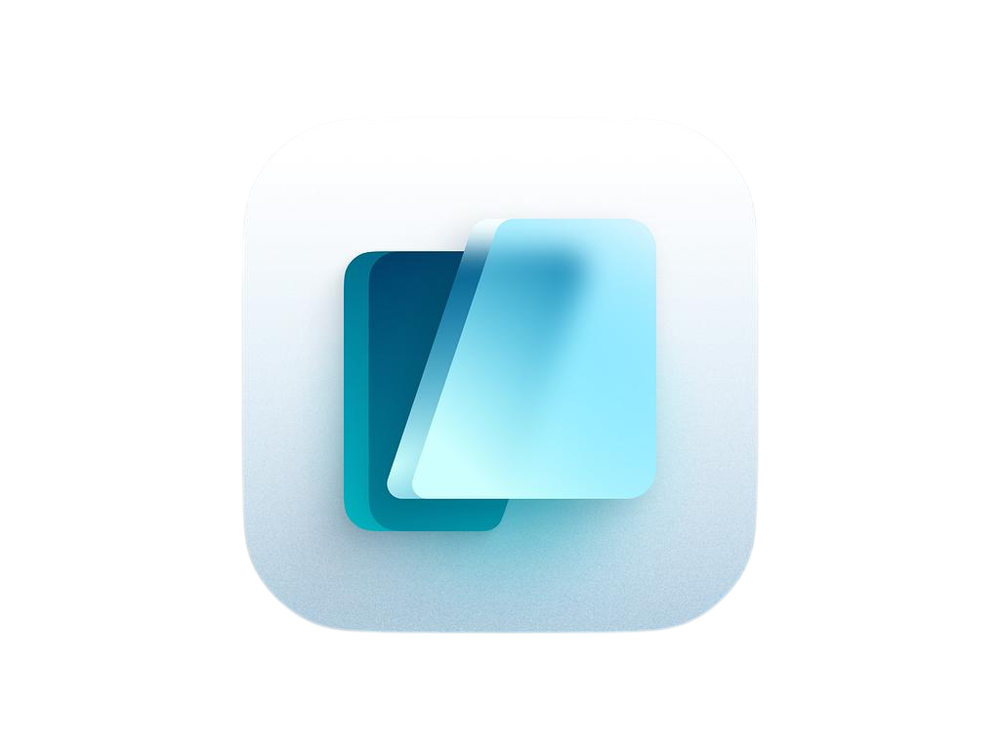

<p align="center">
  
</p>

# Reflex

Controle remoto de tela para Windows, em Rust, para a rede local. Pensado para
administrar máquinas e servidores — inclusive máquinas fracas, sem placa de
vídeo e sem monitor. Um único `reflex.exe` faz tudo: janela do viewer,
serviço do host e linha de comando.

O levantamento completo (decisões, arquitetura, protocolo) está em
[docs/levantamento.md](docs/levantamento.md).

## O que faz

- **Vídeo**: captura DXGI, H.264/HEVC/AV1 por placa de vídeo ou H.264 pela
  CPU com o openh264 da Cisco; refino da imagem com a tela parada.
  Em máquina sem placa (VM, servidor) só o que mudou na tela é lido e
  convertido.
- **Controle total**: teclado (inclusive Win, Alt+Tab e Ctrl+Alt+Del), mouse,
  tela de login, bloqueio e UAC; Caps/Num/Scroll Lock sincronizados.
- **Sem monitor**: instala e liga um monitor virtual
  ([Virtual Display Driver](third_party/vdd/README.md)) quando a máquina não
  tem tela ativa.
- **Clipboard** com todos os formatos (texto, HTML, RTF, imagens, formatos
  próprios dos programas) e **cópia de arquivos e pastas** colando direto no
  Explorer, com a barra de progresso do Windows, nos dois sentidos.
- **Várias conexões ao mesmo tempo** compartilhando uma captura e um encoder.
- **Reconexão automática** quando a conexão cai (troca de sessão do Windows,
  reinício do serviço).
- **Segurança**: QUIC (com TCP de reserva) sempre em TLS 1.3 mútuo;
  usuários cadastrados por ID de acesso (níveis master, controle total e só
  ver) ou convite por senha (SPAKE2); administração remota pelos masters.
- **Janela** do tamanho da tela remota (ou a tela remota do tamanho da
  janela), cursor remoto sem atraso, opções de qualidade, cor, cursor e
  clipboard.

## Arquitetura

O Reflex é um projeto do [Aylis](https://crates.io/crates/aylis)
(`Reflex.aylisproj`), com as pastas dele:

| Pasta | O que é |
|---|---|
| `forms/` | a janela principal e a de vídeo |
| `rust/` | o código: um crate só, o `reflex.exe` inteiro |
| `rust/generated/` | o que a IDE gera dos forms (não se edita à mão) |
| `runtime/` | onde a IDE põe o exe, ao lado das DLLs (FFmpeg, openh264) |
| `dist/` | o que o Publicar gera (`dist\windows`) |
| `assets/`, `themes/`, `locales/` | imagens (o logo, `assets/images/logo.png`, é o ícone do app), fontes, tema e traduções |
| `.aylis/app-icon.ico` | o ícone do Windows, gerado pela IDE a partir do logo (vai no exe) |

Os módulos de `rust/src/`:

| Módulo | Papel |
|---|---|
| `proto` | mensagens e enquadramento do protocolo |
| `auth` | identidade, usuários, master, convites (SPAKE2) |
| `net` | transporte QUIC + TCP/TLS mútuo |
| `media` | captura DXGI, conversões, codecs (FFmpeg, openh264) |
| `platform` | input, áreas de trabalho, clipboard, arquivos virtuais, pipes, monitor |
| `host` | aceitar conexões, motor de captura compartilhado, ponte com o usuário |
| `viewer` | conexão do viewer, decodificação |
| `forms/`, `sessao`, `video/`, `maquina` | a interface: o código dos forms, a conexão sem tela, a janela de vídeo, a aba "Esta máquina" |
| `modes` | o `main`: interface, serviço, agente, processo do usuário e CLI |

No host, o **serviço** (sessão 0) mantém um **agente** como SYSTEM na sessão
de console — é ele que captura, injeta input e vê a tela de login — e, com
alguém logado, o **processo do usuário**, que cuida do clipboard e dos
arquivos com as permissões de quem está logado.

## Compilar

Requer Windows 10/11 x64, Rust estável e a IDE do Aylis.

Antes, uma vez: `.\scripts\obter-dependencias.ps1`. As bibliotecas
carregadas em tempo de execução não estão no repositório; o script baixa o
FFmpeg 7.1 LGPL e o openh264 da Cisco pra `runtime\` (ver
[runtime/README.md](runtime/README.md)).

Na IDE do Aylis, abra o `Reflex.aylisproj`: Compilar (Ctrl+F9) e Executar (F9)
põem o `reflex.exe` em `runtime\`. Sem a IDE, `cargo build` em `rust\`.

O **Publicar** gera `dist\windows\` com só o que vai pra outra máquina: o
`reflex.exe` e as DLLs do FFmpeg. Copie a pasta e rode `reflex.exe --install`
como administrador — ele baixa o openh264 da Cisco (é a condição da licença de
patente do H.264) e confere o hash.

## Uso

```
reflex                                   janela principal
reflex --connect <endereço>              conecta já (ip ou nome, porta opcional; padrão 47800); fechar o vídeo fecha
reflex --my-id                           ID de acesso deste viewer
reflex --install / --uninstall           serviço, firewall, monitor virtual (admin)
reflex --add-user <ID> <nome> <nível>    master | full | view (admin)
reflex --status                          estado, ID da máquina, endereços, usuários (admin)
reflex --admin <endereço> ...            administração remota (master)
reflex --probe <endereço> [s] [png] ...  viewer sem janela, pra testes e medidas
reflex --baixar-openh264 <pasta>         baixa o openh264 da Cisco (o --install já baixa)
reflex --service | --agent | --user      iniciados pelo próprio Reflex
```

Logs: `C:\ProgramData\Reflex\logs` (serviço, agente) e
`%LOCALAPPDATA%\Reflex\logs` (interface, processo do usuário). Com uma conexão
aberta, o host manda a cada 5 s os tempos do motor e o uso de CPU, que vão
pro log da interface (`host: motor …`).

## Testes

Pela IDE (o `test` do Aylis) ou `cargo test` em `rust\`. Os que precisam de
GPU, monitor, FFmpeg ou do clipboard de verdade ficam marcados `#[ignore]`
(os de integração estão em `rust\tests\`):

```
cargo test --test pipeline -- --ignored --nocapture
cargo test --test end_to_end -- --ignored --nocapture
```

### Numa VM Hyper-V

Num PowerShell **como administrador**, na pasta do projeto:

```
Set-ExecutionPolicy -Scope Process -ExecutionPolicy Bypass -Force
. .\scripts\vm-conectar.ps1                     # pede a senha da VM uma vez
& .\scripts\testar-vm.ps1 -ViewerId <seu ID>    # copia dist\windows (Publicar), instala e cadastra o master
```

No *Default Switch* a VM muda de IP a cada reinício do PC: conecte pelo nome
do computador com `.mshome.net` (ex.: `DESKTOP-XXXX.mshome.net`).

## Licença

[MIT](LICENSE) para o código do Reflex.

As dependências binárias têm licenças próprias, todas compatíveis com
distribuir o Reflex como MIT: o
[Virtual Display Driver](third_party/vdd/LICENSE) é MIT; o
[FFmpeg](runtime/README.md#ffmpeg) é a build LGPL (carregada como DLL);
o [openh264](runtime/README.md#openh264) é BSD, baixado da Cisco na
instalação (OpenH264 Video Codec provided by Cisco Systems, Inc.).

Pendências do projeto: [docs/pendencias.md](docs/pendencias.md).
